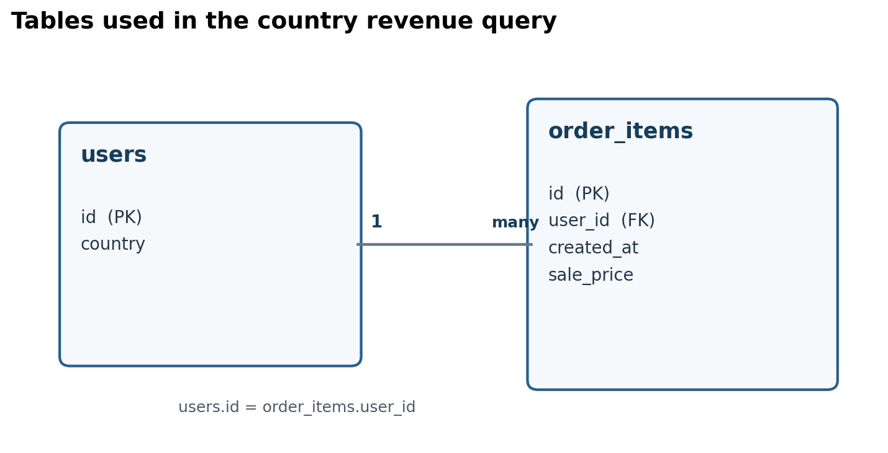

# Dataset documentation and table notes

## Dataset

- **Dataset ID:** `bigquery-public-data.thelook_ecommerce`
- **BigQuery project:** `bigquery-public-data`
- **Table browser:** Open the dataset in BigQuery Explorer and inspect each table's **Details**, **Schema**, and **Preview** tabs.
- **Google documentation:** [BigQuery e-commerce analytics codelab](https://codelabs.developers.google.com/codelabs/bigquery-measures?hl=en). The codelab introduces theLook e-commerce tables and illustrates order-item measures. Use BigQuery's live schema as the authority for the exact table fields and types in this project.
- **Team output:** [Country-year results in Google Sheets](https://docs.google.com/spreadsheets/d/1rDDExt7Uf89crvoLI5ZjTG0p1JqFMs49nnnk2eYQmJY/edit?gid=1679571377#gid=1679571377).
- **Belgium category output:** [Category results in Google Sheets](https://docs.google.com/spreadsheets/d/1jXNwfXJ5pRDnpHl_6pYGra9pCK5BWavyb9ZEVs8Khlg/edit?usp=sharing). Its category percentages imply about 296 Belgian purchasers, compared with the earlier result of 286; see [findings.md](../findings.md).

## Tables used

| Table | Columns used | Role in analysis |
|---|---|---|
| `users` | `id`, `country`, `age`, `gender`, `traffic_source`, `created_at` | User identifier, recorded country, age, gender, acquisition channel, and signup timestamp |
| `order_items` | `id`, `user_id`, `created_at`, `sale_price`, `status` | Order-item identifier, user join key, year filter, recorded item value, and current item status |
| `products` | `id`, `category` (assumed for CP2 query 08; verify in BigQuery) | Product identifier and category label for category-purchase features |

The country analysis joins `order_items.user_id` to `users.id`. The CP2 customer table in query 13 joins order items to users, filters current item statuses `Cancelled` and `Returned`, and uses user attributes plus `users.created_at` to derive signup month and days active in 2025. The older draft CP2 table also uses `products.category`; confirm those fields before running the historical queries. Confirm the live column meanings and types in BigQuery.

## Table diagram

[Printable table diagram (PDF)](table_diagram.pdf)

The editable DBML source is [thelook_revenue_erd.dbml](thelook_revenue_erd.dbml).
