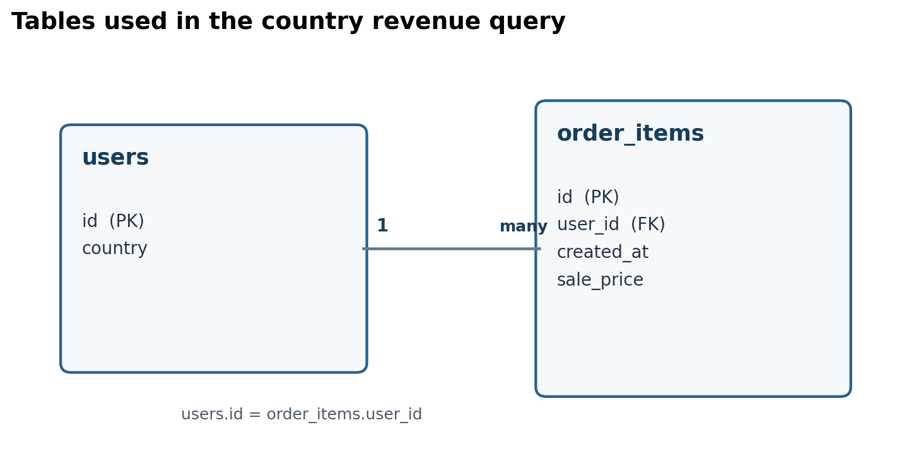

# Dataset documentation and table notes

## Dataset

- **Dataset ID:** `bigquery-public-data.thelook_ecommerce`
- **BigQuery project:** `bigquery-public-data`
- **Table browser:** Open the dataset in BigQuery Explorer and inspect each table's **Details**, **Schema**, and **Preview** tabs.
- **Google documentation:** [BigQuery e-commerce analytics codelab](https://codelabs.developers.google.com/codelabs/bigquery-measures?hl=en). The codelab introduces theLook e-commerce tables and illustrates order-item measures. Use BigQuery's live schema as the authority for the exact table fields and types in this project.
- **Team output:** [Country-year results in Google Sheets](https://docs.google.com/spreadsheets/d/1rDDExt7Uf89crvoLI5ZjTG0p1JqFMs49nnnk2eYQmJY/edit?gid=1679571377#gid=1679571377).

## Tables used

| Table | Columns used | Role in analysis |
|---|---|---|
| `users` | `id`, `country` | User identifier and user's recorded country |
| `order_items` | `id`, `user_id`, `created_at`, `sale_price` | Order-item identifier, user join key, year grouping field, and value summed |

The analysis joins `order_items.user_id` to `users.id`. The query uses an inner join, so order items without a matched user are excluded. The unit of analysis is one user-country group per year of order-item `created_at`. The team should confirm the displayed column descriptions and types in BigQuery and add any important documentation notes here.

## Table diagram

The editable DBML source is [thelook_revenue_erd.dbml](thelook_revenue_erd.dbml).
